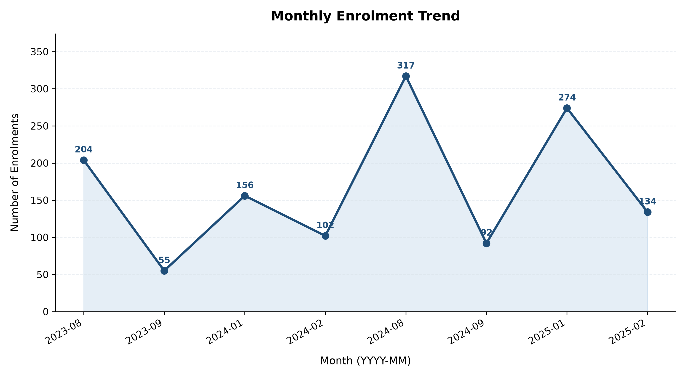
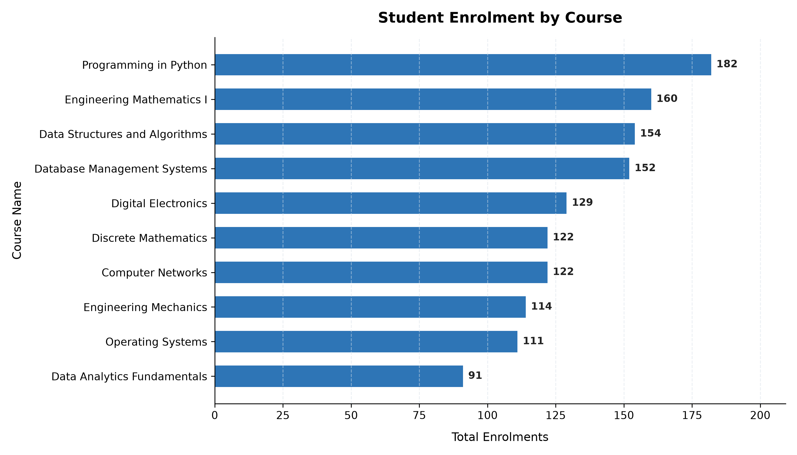
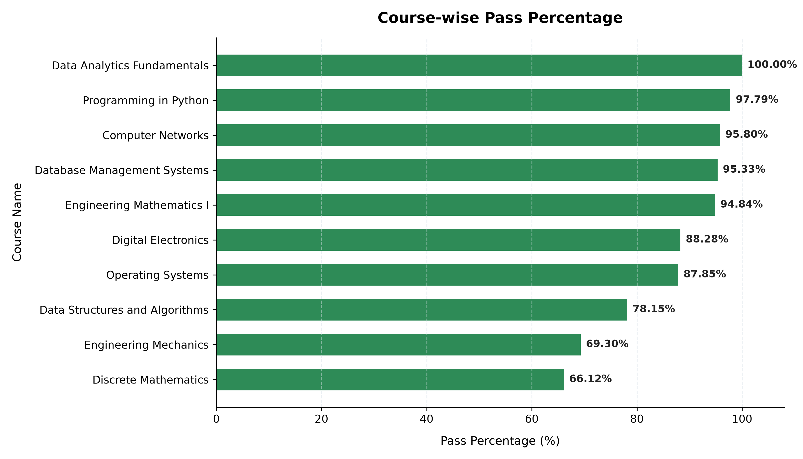
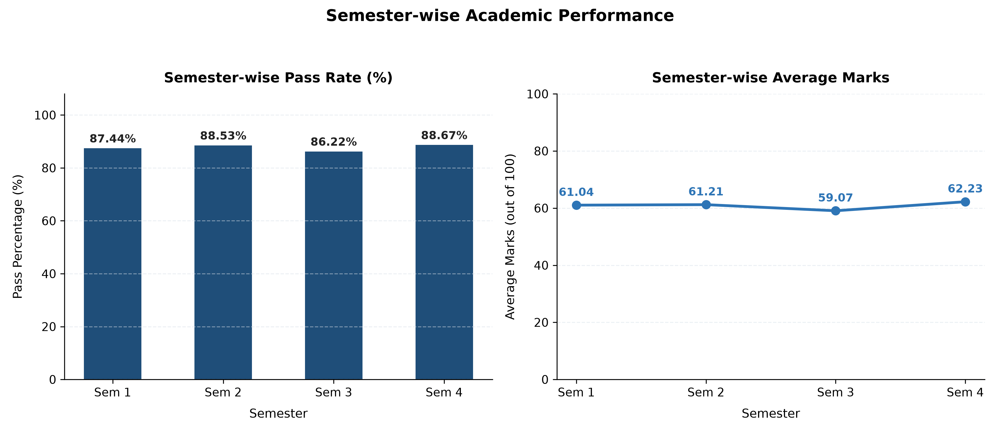

# Course Enrolment and Pass Rate Analysis

An end-to-end academic data analytics project built with **Python (Pandas, NumPy, Matplotlib)**, **Jupyter Notebook**, and **Excel data governance** to clean student enrolment records, compute verified academic KPIs, and uncover course-level, semester-level, and department-level performance insights.

---

## Project Overview

Educational institutions collect large volumes of student, course, and examination records every semester, yet raw spreadsheets frequently contain duplicate rows, inconsistent text casing, mixed date formats, missing values, and out-of-range marks. This project provides a reproducible pipeline that:

1. Generates a realistic multi-table synthetic B.Tech dataset (`students.csv`, `courses.csv`, `enrolments.csv`) with controlled data-quality defects (`RANDOM_SEED = 42`).
2. Applies transparent, non-destructive data cleaning with a full row-count audit log (`reports/data_quality_log.csv`).
3. Computes core academic KPIs using the institutional passing threshold (`marks >= 40` out of `100`) and exports verified benchmarks (`reports/kpis.json`).
4. Produces publication-ready Matplotlib charts (`reports/charts/`) and a documented Jupyter Notebook (`notebooks/EDA_Analysis.ipynb`) with 7 embedded charts and automated KPI parity checks.

---

## Objectives

- **Data Quality & Governance:** Define strict table schemas and 11 validation rules in `documentation/data_dictionary.xlsx` and resolve 100% of formatting, duplicate, date, and range anomalies without silent deletions.
- **KPI Accuracy:** Calculate overall, course-wise, semester-wise, department-wise, monthly, and attendance-correlation metrics cleanly, excluding `Missing/Invalid` marks from pass-rate denominators while preserving them for demand totals.
- **Actionable Academic Insights:** Answer five key institutional questions:
  1. Which courses have the highest student enrolment?
  2. Which courses have the highest and lowest pass rates?
  3. What is the overall student pass percentage?
  4. How does student performance vary across semesters?
  5. Which courses require academic improvement based on their failure rates?

---

## Key Features

- **Deterministic Reproducibility:** Fixed seed (`RANDOM_SEED = 42`) across dataset generation, cleaning, and KPI export.
- **Non-Destructive Cleaning & Audit Log:** Raw files in `data/raw/` remain untouched; every cleaning rule and affected row count is logged across 32 checks in `reports/data_quality_log.csv`.
- **Verified KPI Benchmark (`reports/kpis.json`):** Strict JSON output validated against `NaN`/`Infinity` constants and programmatically verified inside `notebooks/EDA_Analysis.ipynb`.
- **Comprehensive Documentation:** Includes Problem Statement, Synopsis, SRS, Excel Data Dictionary, and Final Project Report inside `documentation/`.

---

## Technology Stack

- **Python 3** — `pandas`, `numpy`, `matplotlib`
- **Jupyter Notebook** — Interactive EDA with 7 embedded charts and KPI parity assertions
- **Microsoft Excel** — Data dictionary and quality rules (`documentation/data_dictionary.xlsx`)
- **JSON / CSV / Markdown** — Structured KPI exports, audit logging, and technical reporting

---

## Repository Structure

```text
Course-Enrolment-and-Pass-Rate-Analysis/
├── data/
│   ├── raw/
│   │   ├── students.csv                    # 255 raw student records (with duplicates & dirty formats)
│   │   ├── courses.csv                     # 10 raw B.Tech courses
│   │   └── enrolments.csv                  # 1,347 raw enrolment records
│   └── clean/
│       ├── students.csv                    # 250 cleaned unique students
│       ├── courses.csv                     # 10 cleaned courses
│       └── enrolments.csv                  # 1,337 cleaned unique enrolments
├── documentation/
│   ├── problem_statement.docx              # Project definition & business questions
│   ├── synopsis.docx                       # Project synopsis & scope
│   ├── SRS.docx                            # Software Requirements Specification
│   ├── data_dictionary.xlsx                # Schema & 11 data quality rules
│   └── Final_Project_Report.md             # Complete final project report
├── notebooks/
│   └── EDA_Analysis.ipynb                  # Interactive EDA notebook (7 embedded charts, KPI parity)
├── powerbi/
│   └── PowerBI_Implementation_Guide.md     # Reference Power BI guide (implementation skipped by scope decision)
├── python/
│   ├── generate_dataset.py                 # Reproducible raw dataset generator (seed=42)
│   ├── data_cleaning.py                    # Data cleaning & audit logging pipeline
│   └── analysis.py                         # KPI computation, JSON export & 4 Matplotlib charts
├── reports/
│   ├── charts/
│   │   ├── monthly_enrolment_trend.png
│   │   ├── course_enrolment_count.png
│   │   ├── course_pass_percentage.png
│   │   └── semester_academic_performance.png
│   ├── data_quality_log.csv                # 32 logged cleaning checks & row counts
│   └── kpis.json                           # Verified KPI & summary benchmark
├── sql/                                    # Reserved for optional SQL extension (not used)
└── README.md
```

---

## Dataset Description

The relational dataset models B.Tech students across 5 departments (`CSE`, `IT`, `ECE`, `ME`, `CE`), 10 courses (`BT101`–`BT110`), Semesters `1–4`, and Academic Years `2023-24` and `2024-25`:

- **`students.csv` (`250` clean rows):** `student_id` (PK), `student_name`, `gender` (`Male`: `128`, `Female`: `117`, `Unknown`: `5`), `department`, `admission_year` (`2023`: `158`, `2024`: `92`).
- **`courses.csv` (`10` clean rows):** `course_id` (PK), `course_name`, `course_category` (`Foundation`, `Core`, `Elective`), `credits` (`3` or `4`).
- **`enrolments.csv` (`1,337` clean rows):** `enrolment_id` (PK), `student_id` (FK), `course_id` (FK), `semester`, `academic_year`, `enrolment_date` (ISO `YYYY-MM-DD`), `marks` (`0–100`), `attendance_percentage` (`0–100`), `result` (`Pass`, `Fail`, `Missing/Invalid`).

---

## Data Cleaning Process

`python/data_cleaning.py` reads `data/raw/` read-only and outputs `data/clean/` plus `reports/data_quality_log.csv`:

- **Deduplication:** Standardised PK/FK IDs first, then removed `5` exact duplicate student rows and `10` exact duplicate enrolment rows (`0` non-exact PK duplicates).
- **Text & Category Standardisation:** Fixed whitespace/casing in `student_name` (`3`), `department` (`5`), `course_category` (`3`); mapped `gender` variants (`5`) and filled `5` missing genders with `'Unknown'`.
- **Missing & Out-of-Range Handling (No Silent Deletions):** Inferred `2` missing `admission_year` values from Semester 1 `academic_year`; converted `6` text semesters (e.g., `'Sem 1'`) to integers (`1–4`); cleared `8` out-of-range marks (`<0` or `>100`) to `null` alongside `12` missing marks; preserved `10` missing attendance values as `null`.
- **Date Standardisation:** Standardised `21` mixed-format valid dates (`DD/MM/YYYY`, `DD-Mon-YYYY`, `YYYY/MM/DD`) to `YYYY-MM-DD` and set `3` invalid calendar dates (`2024-13-45`) to `null`.
- **Result Enforcement & Integrity:** Enforced `marks >= 40` → `Pass`, `< 40` → `Fail`, unavailable → `Missing/Invalid` (`8` missing + `32` inconsistent/recalculated); confirmed `0` orphan foreign keys.

---

## Key KPIs (Verified from `reports/kpis.json`)

| Metric | Value | Details |
| :--- | :---: | :--- |
| **Total Students** | `250` | `CSE`: `86`, `ME`: `49`, `IT`: `46`, `ECE`: `42`, `CE`: `27` |
| **Total Courses** | `10` | `BT101`–`BT110` |
| **Total Enrolments** | `1,337` | `517` (`2023-24`) + `820` (`2024-25`) |
| **Valid Graded Enrolments** | `1,317` | Excludes `20` `Missing/Invalid` rows |
| **Passed / Failed Enrolments** | `1,156` / `161` | Passing threshold: `40 / 100` |
| **Overall Pass Rate / Fail Rate** | `87.78%` / `12.22%` | Computed over `1,317` valid graded rows |
| **Average Marks** | `60.94` | Mean across `1,317` valid graded records |
| **Highest Enrolment Course** | `BT102` (`182`) | *Programming in Python* (`97.79%` pass rate) |
| **Highest Pass Rate Course** | `BT110` (`100.00%`) | *Data Analytics Fundamentals* (`91/91`, avg `77.46`) |
| **Courses Needing Improvement** | `BT108`, `BT106`, `BT103` | `66.12%` (`41` fails), `69.30%` (`35` fails), `78.15%` (`33` fails) — `67.70%` of all failures |
| **Attendance vs. Marks** | `r = 0.7539` | `1,307` paired rows; Pass avg `79.73%` vs. Fail avg `64.32%` |

---

## Visualizations

### 1. Monthly Enrolment Trend


### 2. Student Enrolment by Course


### 3. Course-wise Pass Percentage


### 4. Semester-wise Academic Performance


*(Seven additional interactive EDA charts — including department-wise enrolment, department-wise pass rate, and attendance vs. marks scatter analysis — are embedded in `notebooks/EDA_Analysis.ipynb`.)*

---

## How to Run the Project Locally

1. **Clone the repository:**
   ```bash
   git clone https://github.com/RashmiSingh287/Course-Enrolment-and-Pass-Rate-Analysis.git
   cd Course-Enrolment-and-Pass-Rate-Analysis
   ```

2. **Install Python dependencies:**
   ```bash
   pip install pandas numpy matplotlib jupyter
   ```

3. **Run the Python pipeline (optional if regenerating outputs from scratch):**
   ```bash
   python python/generate_dataset.py
   python python/data_cleaning.py
   python python/analysis.py
   ```

4. **Explore the Jupyter Notebook:**
   ```bash
   jupyter notebook notebooks/EDA_Analysis.ipynb
   ```

---

## Project Limitations

- **Synthetic Data:** All records are generated programmatically (`RANDOM_SEED = 42`) rather than sourced from a live university ERP system.
- **Two Admission Cohorts (`2023`, `2024`):** Only the `2023` batch has reached Semesters `3` and `4`, resulting in lower enrolment counts in Semesters `3–4` (`256` and `261`) compared to Semesters `1–2` (`413` and `407`).
- **Scope Decision on BI & SQL:** Power BI `.pbix` dashboard creation and optional SQL querying were omitted from the final deliverable (`powerbi/PowerBI_Implementation_Guide.md` remains available as reference documentation).
- **Observational Correlation:** The strong positive correlation between attendance and marks (`r = 0.7539`) indicates linear association only and does not establish causation.

---

## Future Improvements

- Integrate directly with live institutional ERP/LMS exports and automated data-entry validation forms.
- Expand longitudinal tracking across all 8 B.Tech semesters.
- Add automated mid-semester early-warning alerts for students with low attendance or poor internal scores.
- Optionally implement the interactive dashboard design documented in `powerbi/PowerBI_Implementation_Guide.md`.
