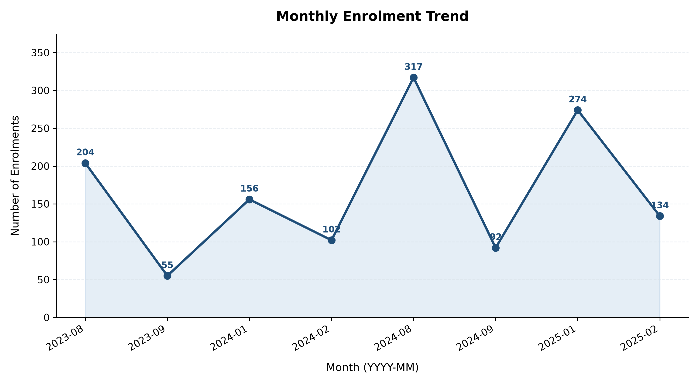
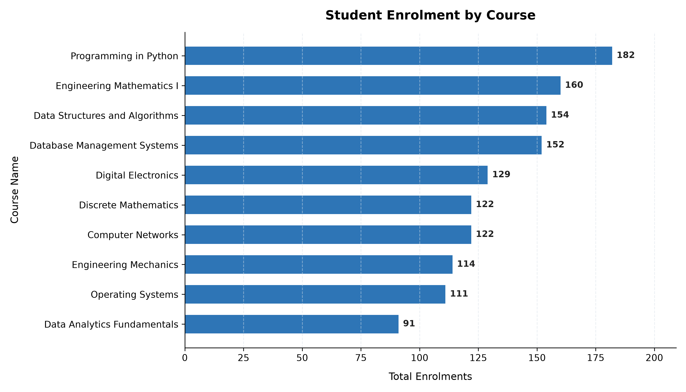
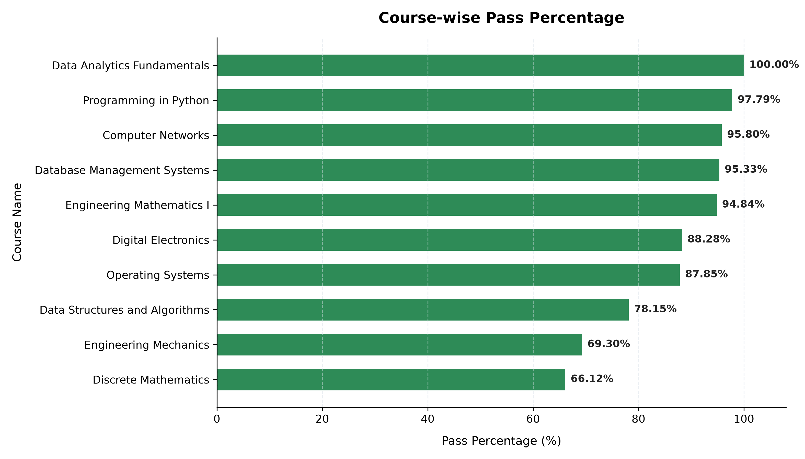
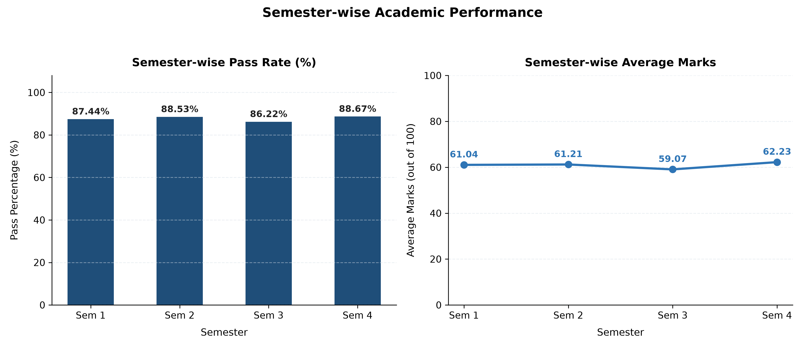

# Final Project Report: Course Enrolment and Pass Rate Analysis

**Author:** Rashmi Singh  
**Program:** B.Tech (2nd Year)  
**Institution:** ABES Engineering College  
**Domain:** Education and Academic Analytics  
**Repository:** `Course-Enrolment-and-Pass-Rate-Analysis`  

---

## 1. Introduction

Academic institutions generate student enrolment records, attendance logs, and examination scores across every semester. When these records remain in raw, unvalidated spreadsheets, faculty and academic coordinators face formatting inconsistencies, duplicate rows, missing values, and unverified calculations that make timely academic review difficult.

The **Course Enrolment and Pass Rate Analysis** project establishes a reproducible, end-to-end academic data analytics pipeline in Python. Using structured data generation, transparent rule-based data cleaning, automated Key Performance Indicator (KPI) computation, publication-quality Matplotlib charts, and an interactive Jupyter Notebook, the project converts raw multi-table student and course records into verified academic insights.

---

## 2. Problem Statement

Raw academic records across semesters often suffer from duplicate entries, inconsistent text formatting, mixed date styles, missing scores, and out-of-range marks. Without a consolidated and auditable analytics workflow, academic coordinators cannot reliably answer fundamental operational questions:

1. **Which courses have the highest student enrolment?**
2. **Which courses have the highest and lowest pass rates?**
3. **What is the overall student pass percentage?**
4. **How does student performance vary across semesters?**
5. **Which courses require academic improvement based on their failure rates?**

This project addresses these challenges by enforcing documented data-quality rules (`documentation/data_dictionary.xlsx`), preserving non-duplicate rows with zero silent deletions, exporting verified KPIs (`reports/kpis.json`), and presenting clear visual evidence for curriculum and student support planning.

---

## 3. Project Objectives

1. **Reproducible Dataset & Schema Definition:** Build a structured relational academic dataset (~250 students across 5 B.Tech departments, 10 courses, and Semesters 1–4) with controlled data-quality issues and a complete Excel data dictionary.
2. **Auditable Data Cleaning:** Clean 100% of duplicate, formatting, date, and domain-range issues in Python (`python/data_cleaning.py`), preserving raw files untouched and logging every rule and affected row count in `reports/data_quality_log.csv`.
3. **KPI Computation & Parity:** Compute core enrolment and academic performance KPIs using the institutional passing rule (`marks >= 40` out of `100`) and verify 100% parity between `python/analysis.py`, `reports/kpis.json`, and `notebooks/EDA_Analysis.ipynb`.
4. **Visual & Exploratory Reporting:** Produce four labelled Matplotlib charts (`reports/charts/`) and a documented Jupyter Notebook (`notebooks/EDA_Analysis.ipynb`) with seven embedded visualisations answering all five business questions.

> **Scope Note:** Initial planning documents (`problem_statement.docx`, `synopsis.docx`, `SRS.docx`) and `powerbi/PowerBI_Implementation_Guide.md` also outlined a Power BI dashboard and an optional SQLite extension. By final project decision, Power BI dashboard construction (`.pbix`) and optional SQL execution were skipped, and the delivered analytical solution is completed cleanly through Python, Excel documentation, and Jupyter Notebook.

---

## 4. Tools and Technologies

| Category | Tool / Technology | Role in Project |
| :--- | :--- | :--- |
| **Programming Language** | Python 3 | Core pipeline for data generation, cleaning, KPI calculation, and plotting |
| **Data Manipulation** | Pandas, NumPy | Tabular joins, deduplication, type validation, aggregations, and correlation |
| **Visualisation** | Matplotlib | Generation of 4 high-resolution (`300 DPI`) PNG charts and 7 notebook plots |
| **Interactive Analysis** | Jupyter Notebook | Step-by-step EDA, Markdown commentary, and KPI parity verification |
| **Data Governance** | Microsoft Excel (`data_dictionary.xlsx`) | Schema definition, PK/FK constraints, and 11 documented data-quality rules |
| **Output & Reporting** | JSON, CSV, Markdown | Machine-readable KPI benchmark (`kpis.json`), audit log, and project reports |
| **Version Control** | Git & GitHub | Source control and project delivery |

---

## 5. Dataset Description

All datasets follow a relational schema defined in `documentation/data_dictionary.xlsx` and are generated deterministically by `python/generate_dataset.py` using `RANDOM_SEED = 42`.

| Dataset | Raw Rows (`data/raw/`) | Clean Rows (`data/clean/`) | Columns | Primary / Foreign Keys |
| :--- | :---: | :---: | :---: | :--- |
| `students.csv` | 255 | 250 | 5 | PK: `student_id` (`STU0001`–`STU0250`) |
| `courses.csv` | 10 | 10 | 4 | PK: `course_id` (`BT101`–`BT110`) |
| `enrolments.csv` | 1,347 | 1,337 | 9 | PK: `enrolment_id` (`ENR00001`–`ENR01337`); FK: `student_id`, `course_id` |

### Table Schemas & Distributions (Cleaned Data)

1. **`students.csv` (`250` unique students):**
   - `student_id`, `student_name`, `gender` (`Male`: `128`, `Female`: `117`, `Unknown`: `5`), `department` (`CSE`: `86`, `ME`: `49`, `IT`: `46`, `ECE`: `42`, `CE`: `27`), `admission_year` (`2023`: `158`, `2024`: `92`).
2. **`courses.csv` (`10` B.Tech courses):**
   - `course_id`, `course_name`, `course_category` (`Core`: `6`, `Foundation`: `3`, `Elective`: `1`), `credits` (`3` or `4`).
3. **`enrolments.csv` (`1,337` unique enrolments):**
   - `enrolment_id`, `student_id`, `course_id`, `semester` (`1`–`4`), `academic_year` (`2023-24`: `517`, `2024-25`: `820`), `enrolment_date` (ISO `YYYY-MM-DD`; `3` unparseable dates retained as `null`), `marks` (`0–100`; `20` unavailable/invalid retained as `null`), `attendance_percentage` (`0–100`; `10` missing retained as `null`), `result` (`Pass`, `Fail`, `Missing/Invalid`).

---

## 6. Data Cleaning Methodology

The cleaning pipeline in `python/data_cleaning.py` reads `data/raw/` strictly read-only, writes cleaned files to `data/clean/`, and logs 32 audit checks to `reports/data_quality_log.csv` without silently deleting non-duplicate records.

| Table | Issue Identified | Rule Applied | Rows Affected |
| :--- | :--- | :--- | :---: |
| `students.csv` | Exact duplicate rows | Removed exact duplicates (`keep='first'`) | 5 |
| `students.csv` | Inconsistent `student_name` formatting | Trimmed whitespace & applied Title Case | 3 |
| `students.csv` | Missing `gender` values | Replaced missing values with `'Unknown'` | 5 |
| `students.csv` | Inconsistent `gender` formats | Trimmed spaces & mapped `m`/`male` → `Male`, `f`/`female` → `Female` | 5 |
| `students.csv` | Inconsistent `department` formatting | Trimmed spaces & uppercased (`CSE`, `IT`, `ECE`, `ME`, `CE`) | 5 |
| `students.csv` | Missing `admission_year` | Inferred from Semester 1 `academic_year` | 2 |
| `courses.csv` | Inconsistent `course_category` formatting | Trimmed spaces & converted to Title Case | 3 |
| `enrolments.csv` | Exact duplicate rows | Removed exact duplicates (`keep='first'`) | 10 |
| `enrolments.csv` | Non-numeric `semester` labels (`'Sem 1'`) | Extracted integer semester (`1–4`) as nullable `Int64` | 6 |
| `enrolments.csv` | Mixed valid `enrolment_date` formats | Standardised `DD/MM/YYYY`, `DD-Mon-YYYY`, `YYYY/MM/DD` to `YYYY-MM-DD` | 21 |
| `enrolments.csv` | Invalid/unparseable `enrolment_date` | Set unparseable values (e.g., `'2024-13-45'`) to `null` | 3 |
| `enrolments.csv` | Missing `marks` | Retained as `null`; excluded from pass-rate & mean denominators | 12 |
| `enrolments.csv` | Invalid out-of-range `marks` (`<0` or `>100`) | Converted `8` out-of-range scores to `null` without deleting rows | 8 |
| `enrolments.csv` | Missing `attendance_percentage` | Retained as `null` without deleting rows | 10 |
| `enrolments.csv` | Missing `result` in raw data | Recalculated from valid marks or set to `'Missing/Invalid'` | 8 |
| `enrolments.csv` | Inconsistent / recalculated `result` | Standardised text & enforced `marks >= 40` → `Pass`, `< 40` → `Fail` | 32 |
| `enrolments.csv` | Referential integrity (`student_id`, `course_id`) | Verified all FK keys exist in cleaned parent tables (orphans = `0`) | 0 |

---

## 7. Exploratory Data Analysis

Exploratory analysis was conducted in `python/analysis.py` and expanded in `notebooks/EDA_Analysis.ipynb` (27 cells, 7 embedded charts, and programmatic KPI parity assertions against `reports/kpis.json`). Key analytical rules applied consistently across all metrics:

- **Enrolment Demand Denominator:** Uses all `1,337` unique cleaned enrolment records.
- **Academic Performance Denominator:** Uses the `1,317` valid graded records (`Pass` or `Fail`), excluding the `20` `Missing/Invalid` rows (`12` missing marks + `8` out-of-range marks) so pass/fail percentages are not artificially depressed.
- **Monthly Trend Filter:** Uses the `1,334` records with valid ISO `enrolment_date` values (`3` unparseable null dates excluded).
- **Attendance vs. Marks Analysis:** Uses the `1,307` paired non-null `(attendance_percentage, marks)` records.

---

## 8. KPI Results

All results below are verified directly against `reports/kpis.json`:

### 8.1 Overall Academic KPIs

| KPI | Verified Value | Notes |
| :--- | :---: | :--- |
| **Total Students** | `250` | Unique students in `data/clean/students.csv` |
| **Total Courses** | `10` | B.Tech courses (`BT101`–`BT110`) |
| **Total Enrolments** | `1,337` | `517` in `2023-24`, `820` in `2024-25` |
| **Valid Graded Enrolments** | `1,317` | Excludes `20` `Missing/Invalid` records |
| **Passed Enrolments** | `1,156` | `marks >= 40` |
| **Failed Enrolments** | `161` | `marks < 40` |
| **Overall Pass Rate** | `87.78%` | `1,156 / 1,317 × 100` |
| **Overall Fail Rate** | `12.22%` | `161 / 1,317 × 100` |
| **Average Marks** | `60.94` | Mean across `1,317` valid graded records |
| **Average Attendance** | `77.80%` | Across `1,327` non-null attendance records |

### 8.2 Course-wise Enrolment and Performance

| Course ID | Course Name | Total Enrolments | Valid Graded | Pass Count | Fail Count | Pass Rate (%) | Fail Rate (%) | Avg Marks |
| :--- | :--- | :---: | :---: | :---: | :---: | :---: | :---: | :---: |
| `BT102` | Programming in Python | 182 | 181 | 177 | 4 | 97.79% | 2.21% | 72.84 |
| `BT101` | Engineering Mathematics I | 160 | 155 | 147 | 8 | 94.84% | 5.16% | 62.80 |
| `BT103` | Data Structures and Algorithms | 154 | 151 | 118 | 33 | 78.15% | 21.85% | 55.13 |
| `BT105` | Database Management Systems | 152 | 150 | 143 | 7 | 95.33% | 4.67% | 65.99 |
| `BT104` | Digital Electronics | 129 | 128 | 113 | 15 | 88.28% | 11.72% | 58.01 |
| `BT107` | Computer Networks | 122 | 119 | 114 | 5 | 95.80% | 4.20% | 63.75 |
| `BT108` | Discrete Mathematics | 122 | 121 | 80 | 41 | 66.12% | 33.88% | 44.80 |
| `BT106` | Engineering Mechanics | 114 | 114 | 79 | 35 | 69.30% | 30.70% | 47.32 |
| `BT109` | Operating Systems | 111 | 107 | 94 | 13 | 87.85% | 12.15% | 58.36 |
| `BT110` | Data Analytics Fundamentals | 91 | 91 | 91 | 0 | 100.00% | 0.00% | 77.46 |

### 8.3 Semester-wise Academic Performance

| Semester | Total Enrolments | Valid Graded | Pass Count | Fail Count | Pass Rate (%) | Fail Rate (%) | Avg Marks |
| :---: | :---: | :---: | :---: | :---: | :---: | :---: | :---: |
| Semester 1 | 413 | 406 | 355 | 51 | 87.44% | 12.56% | 61.04 |
| Semester 2 | 407 | 401 | 355 | 46 | 88.53% | 11.47% | 61.21 |
| Semester 3 | 256 | 254 | 219 | 35 | 86.22% | 13.78% | 59.07 |
| Semester 4 | 261 | 256 | 227 | 29 | 88.67% | 11.33% | 62.23 |

### 8.4 Department-wise Summary

| Department | Unique Students | Total Enrolments | Valid Graded | Pass Count | Fail Count | Pass Rate (%) | Fail Rate (%) | Avg Marks |
| :--- | :---: | :---: | :---: | :---: | :---: | :---: | :---: | :---: |
| `CSE` | 86 | 468 | 460 | 404 | 56 | 87.83% | 12.17% | 61.33 |
| `IT` | 46 | 271 | 267 | 233 | 34 | 87.27% | 12.73% | 59.92 |
| `ME` | 49 | 243 | 240 | 207 | 33 | 86.25% | 13.75% | 60.82 |
| `ECE` | 42 | 220 | 217 | 189 | 28 | 87.10% | 12.90% | 61.00 |
| `CE` | 27 | 135 | 133 | 123 | 10 | 92.48% | 7.52% | 61.77 |

### 8.5 Monthly Enrolment Trend & Attendance Correlation

- **Monthly Enrolment Counts (`1,334` dated rows across 8 active registration months):**
  - `2023-08`: `204` | `2023-09`: `55` | `2024-01`: `156` | `2024-02`: `102` | `2024-08`: `317` | `2024-09`: `92` | `2025-01`: `274` | `2025-02`: `134`
- **Attendance vs. Marks (`1,307` paired records):**
  - Average Attendance (Pass): **`79.73%`** vs. Average Attendance (Fail): **`64.32%`**
  - Pearson Correlation (`r`): **`0.7539`** (strong positive linear association; correlation does not imply causation)

---

## 9. Charts and Visualizations

The four primary Matplotlib charts saved in `reports/charts/` are listed below (and seven interactive plots are embedded inside `notebooks/EDA_Analysis.ipynb`):

1. **Monthly Enrolment Trend** — `reports/charts/monthly_enrolment_trend.png`  
   

2. **Student Enrolment by Course** — `reports/charts/course_enrolment_count.png`  
   

3. **Course-wise Pass Percentage** — `reports/charts/course_pass_percentage.png`  
   

4. **Semester-wise Academic Performance** — `reports/charts/semester_academic_performance.png`  
   

---

## 10. Key Findings

1. **Course Demand Concentration:** `BT102` (*Programming in Python*) is the most enrolled course (**182** enrolments), followed by `BT101` (*Engineering Mathematics I*, **160**) and `BT103` (*Data Structures and Algorithms*, **154**), while `BT110` (*Data Analytics Fundamentals*) has the lowest enrolment (**91**).
2. **Strong Overall Academic Performance:** Across `1,317` valid graded records, the institution achieved an **87.78%** pass rate (`1,156` passes, `161` fails) and an average score of **60.94/100**.
3. **High-Failure Bottleneck Courses:** Three subjects — `BT108` (*Discrete Mathematics*, **41** failures / **33.88%** fail rate / `44.80` avg marks), `BT106` (*Engineering Mechanics*, **35** failures / **30.70%** fail rate / `47.32` avg marks), and `BT103` (*Data Structures and Algorithms*, **33** failures / **21.85%** fail rate / `55.13` avg marks) — account for **`109` of all `161` failures (`67.70%`)**.
4. **Top Performing Course:** `BT110` (*Data Analytics Fundamentals*) achieved a **100.00%** pass rate (`91/91`, avg marks **77.46**), followed by `BT102` (**97.79%**).
5. **Consistent Semester Trends:** Pass rates stay stable across Semesters `1–4` (`87.44%`, `88.53%`, `86.22%`, `88.67%`), with a slight dip in Semester `3` (`59.07` avg marks) followed by recovery in Semester `4` (`62.23` avg marks). Higher enrolment volume in Semesters `1` (`413`) and `2` (`407`) reflects both the `2023` and `2024` admission cohorts.
6. **Departmental Highlights:** `CSE` generates the largest enrolment volume (**468** enrolments from **86** students), while `CE` recorded the highest pass rate (**92.48%**).
7. **Attendance Association:** Students who passed averaged **79.73%** attendance compared to **64.32%** among failed records (`r = 0.7539`), highlighting attendance monitoring as a useful early-warning indicator rather than a sole causal factor.

---

## 11. Conclusion

The **Course Enrolment and Pass Rate Analysis** project successfully delivers a reproducible, auditable academic analytics pipeline from raw data generation through cleaning, KPI validation, and exploratory visualisation. All `1,337` cleaned enrolment records, `32` data-quality log checks, `reports/kpis.json`, four PNG charts, and seven embedded notebook visualisations reconcile without discrepancy. The findings give faculty and academic coordinators clear, data-backed evidence to focus remedial support on `BT108`, `BT106`, and `BT103`, monitor attendance early, and enforce standardised mark/date entry templates.

---

## 12. Future Scope

- **ERP / LMS Integration:** Connect the cleaning and KPI pipeline to live institutional ERP exports rather than synthetic CSV files.
- **Automated Input Validation:** Enforce schema checks (`0–100` numeric bounds, ISO dates, dropdown department/category codes) at data-entry time to eliminate `Missing/Invalid` marks and invalid dates.
- **Cohort & Longitudinal Tracking:** Track individual student progression across Semesters `1–8` as newer admission batches advance.
- **Early-Warning Flagging & Optional BI Layer:** Build automated mid-semester risk alerts (combining attendance and internal assessment scores) or implement the documented dashboard design in `powerbi/PowerBI_Implementation_Guide.md` if interactive BI reporting is needed later.
